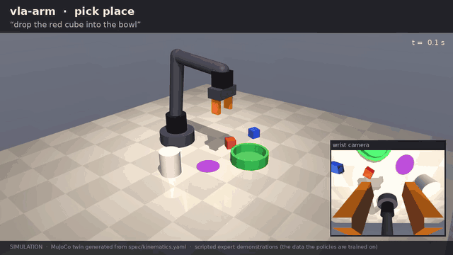
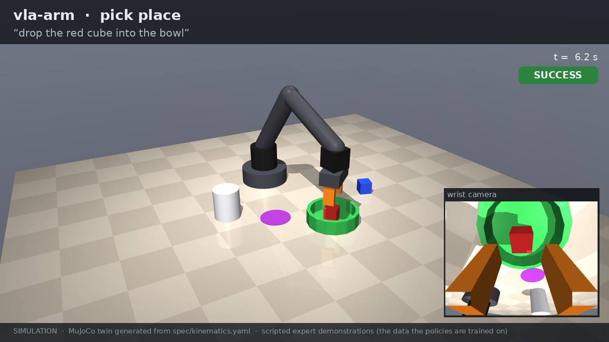
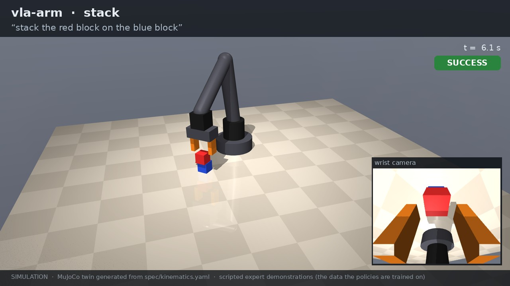
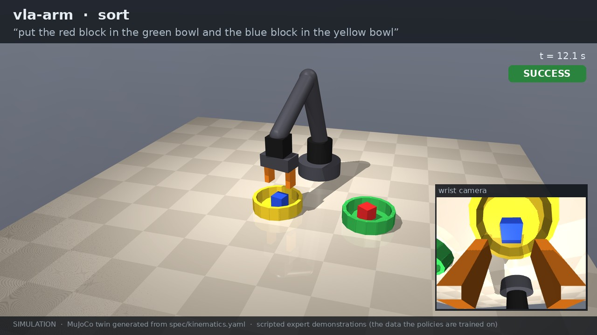

# vla-arm

A low-cost desktop robot arm (5 joints + gripper) with its own STM32G474 controller board and firmware, taught by teleoperated demonstrations and driven by imitation-learning and vision-language-action policies running on a Jetson Orin Nano.

Plan: [docs/PLAN.md](docs/PLAN.md). Decisions and spec changes: [spec/DECISIONS.md](spec/DECISIONS.md).

**Simulation, 2× speed.** The MuJoCo twin generated from `spec/kinematics.yaml` (servo torque limits, gripper
coupling, cameras), driven by the scripted expert that records the training demonstrations. The inset is the
wrist camera the policies see. Full 44 s clip at real speed: [arm-demo.mp4](docs/media/arm-demo.mp4).
Regenerate: `MUJOCO_GL=egl python -m sim.demo_video`.

| pick_place | stack | sort (needs the instruction) |
|:---:|:---:|:---:|
|  |  |  |

| Directory | What | Tests |
|---|---|---|
| `spec/` | Single source of truth: kinematics, host↔board protocol (v1.1) | — |
| `firmware/` | C11 portable core, Linux sim harness, `libarmfw`, STM32G474 target | `ctest` (also ASan/UBSan), cross-build |
| `armctl/` | Python host driver: protocol, FK/IK, safety shim, calibration, teleop, mock board | `pytest` |
| `tests/integration/` | `armctl` driving the compiled firmware (`fw_sim`) over a pipe | `pytest` |
| `hardware/` | CadQuery parts, torque/power budget, SKiDL board netlist, BOM, ERC | `pytest` |
| `sim/` | MuJoCo twin generated from the spec, tasks, scripted experts, LeRobot recording | `pytest` |
| `policies/` | ACT / Diffusion Policy / language-conditioned ACT training and sim eval | `pytest` |

Each directory's README has build and test commands. CI (`.github/workflows/ci.yml`) runs all of them.

**Status:** software built and tested without hardware; nothing has been fabricated or run on a real board yet. See the "Not verified" lists in `firmware/README.md` and `hardware/README.md` before ordering parts.
